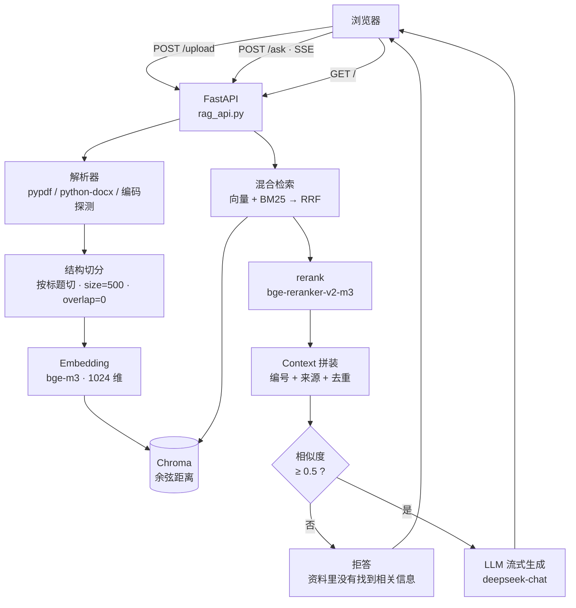

# 文档问答系统（RAG）

> 上传 PDF / Word / TXT，用自然语言提问，得到**带 `[n]` 出处**的回答；
> 文档里没有的问题会明确说"资料里没有"，不编造。

一个完整的 RAG（检索增强生成）应用：**解析 → 切分 → 向量化 → 混合检索 → 精排 → 流式生成 → 引用溯源**，前后端 + 部署全部自己完成。

---

## 功能

| 能力 | 说明 |
|---|---|
| **上传即入库** | PDF / DOCX / TXT / MD → 解析 → 结构切分 → 向量化 → Chroma |
| **混合检索** | 向量（bge-m3）+ BM25（jieba 分词）+ RRF 融合 |
| **精排** | 硅基流动 `bge-reranker-v2-m3` 对召回结果重新打分 |
| **流式输出** | SSE 逐字推送，首字 < 1 秒 |
| **引用溯源** | 每个结论标 `[n]`，可定位到「文档 · 页码 · 章节」 |
| **双层拒答** | 相似度阈值（不调模型）+ prompt 指令（兜底） |
| **成本控制** | 同问题缓存 10 分钟；每 IP 20 次/分钟限流 |

---

## 架构



---

## 本地运行

```powershell
uv sync

# 配置 .env（参考 .env.example）
#   DEEPSEEK_API_KEY=your_key_here
#   SILICONFLOW_API_KEY=your_key_here
#   EMBED_BACKEND=api
#   EMBED_MODEL=BAAI/bge-m3

uv run uvicorn rag_api:app --reload --port 8000
```

打开 http://127.0.0.1:8000

> 首次启动如果向量库为空，会自动从 `samples/` 初始化（约 5 秒）。

### 命令行调试（不启动服务）

```powershell
uv run qa.py "谁负责前端"                  # 单次问答
uv run qa.py "谁负责前端" --no-llm         # 只看检索结果和分数
uv run evaluate.py                         # 检索命中率评测
uv run eval_refusal.py                     # 拒答能力评测
uv run eval.py                             # 回答层端到端评测（30 条）
uv run eval.py --only 同义改写              # 只跑某个类别
uv run ingest.py --rebuild                 # 重建向量库
```

---

## 检索效果（自建评测集）

语料 41 块，评测集 20 条**同义改写**问题（不照抄原文，否则关键词匹配也能中，测不出差别）。

| 方法 | Hit@1 | Hit@3 | MRR |
|---|---|---|---|
| 纯向量 | 75% | 95% | 0.89 |
| BM25 | 55% | 65% | 0.83 |
| 混合 RRF (pool=10) | 70% | 75% | 0.88 |
| **混合 + rerank** | **85%** | **95%** | **0.94** |

**结论：召回已到顶（Hit@3 95%），优化点在排序 —— Hit@1 +10pp，MRR +0.04。**

### 辅助实验：pool 大小的影响

| pool | 3 | 5 | 8 | 10 | 20 | 40 |
|---|---|---|---|---|---|---|
| Hit@3 | 95% | 90% | 80% | 75% | 75% | 75% |

库只有 41 块时，`pool=20` 等于把近一半的库塞进 RRF，BM25 尾部的噪声条目也拿到分数，**稀释了向量的精确结果**。加权 RRF（向量权重 5:1）能追平到 95%，但超不过。

→ **池子大小要按库规模设，不应超过库容的 10–20%。**

### 拒答能力

10 条测试（5 条应回答 + 5 条应拒答），连跑 3 轮：

```
回答率 5/5    拒答率 5/5    综合 10/10（3 轮一致）
```

其中「这个产品的保修期多久」的最高相似度 0.550，高于「哪个型号防水最好」的 0.484，
**但模型仍然拒答** —— 说明 prompt 层在起作用，不是全靠阈值。

详细记录见 [`docs/retrieval-eval.md`](docs/retrieval-eval.md)。

---

## 回答效果（30 条端到端评测）

检索命中 ≠ 回答正确。上面的评测只证明「找得准」，这一层评的是「答得对」。

判定：不拒答 + `must_include` 同义词组每组至少命中一个 + `[n]` 引用不越界 + 不出现串味词。关键词判分便宜、可复现；用同义词组是为了减少「答案对了但用词不同」的假阴性。阈值 `0.50`、`TOP_K=4` 与 `rag_api.py` 完全一致，评的就是线上那个系统。

| 类别 | 条数 | 通过 | 通过率 |
|---|---|---|---|
| 表格数字 | 2 | 2 | 100% |
| 长文档 | 5 | 5 | 100% |
| 应拒答 | 6 | 6 | 100% |
| 事实型 | 6 | 5 | 83% |
| 同义改写 | 6 | 4 | 67% |
| 产品参数 | 5 | 3 | 60% |
| **总计** | **30** | **25** | **83%** |

测试集 30 条覆盖 6 类，问题全部口语化同义改写、不照抄原文；每一组关键词都回 `samples/` 核对过确实存在。明细见 [`docs/eval-report.md`](docs/eval-report.md) 与 `docs/eval-result.json`。

### 失败归因（5 条）

| 归因 | 条数 | 根因 | 该改哪 |
|---|---|---|---|
| 误拒答·阈值拦截 | 2 | sim 0.47 / 0.48 未过 0.50，**根本没调模型** | 调阈值 / 查询改写 / 检索 |
| 误拒答·模型拒答 | 3 | sim 0.54–0.58 过了阈值，但模型看着 context 说「资料里没有」 | 查检索回来的块 / context 拼装 / prompt |

`eval.py` 把这两类分开记，因为**修法完全不同**（教程原版都叫「误拒答」，原代码里「检索未命中」还是永远走不到的死分支）。

### 为什么没动阈值

`THRESHOLD = 0.50` 同时写在 `eval.py` 和已上线的 `rag_api.py`。只改评测侧就变成「评的不是线上系统」；改线上要重新部署，且降阈值会放进无关内容、可能把应拒答 6/6 拉下来（R04 的 sim 已到 0.47），而 3 条「模型拒答」根本不是阈值的锅。

按教程结论：**83% 加清晰归因，比刷到 100% 更可信**。下一步优先做「查询改写」（把口语转成书面语再检索），它同时覆盖两类误拒答、且不需要动线上阈值。

### 验收话术

> 我做了两层评测：检索层 20 条同义改写，Hit@3 95%；回答层 30 条端到端，准确率 83%。
> 最弱的是同义改写 67% 和产品参数 60%。5 条失败里，2 条是口语化查询相似度只有 0.47/0.48 被 0.5 阈值拦掉，另 3 条是过了阈值但模型看着检索内容主动拒答。下一步打算加查询改写，把口语转成书面语再检索。

---

## 部署

```dockerfile
FROM python:3.12-slim
COPY --from=ghcr.io/astral-sh/uv:latest /uv /uvx /bin/
WORKDIR /app
ENV UV_COMPILE_BYTECODE=1 UV_LINK_MODE=copy UV_PYTHON_DOWNLOADS=never PYTHONUNBUFFERED=1
COPY pyproject.toml uv.lock ./
RUN uv sync --frozen --no-dev --no-install-project
COPY . .
ENV PATH="/app/.venv/bin:$PATH"
EXPOSE 8000
CMD ["sh", "-c", "uvicorn rag_api:app --host 0.0.0.0 --port ${PORT:-8000}"]
```

本地验证：

```powershell
docker build -t rag-qa .
docker run --rm -p 8001:8000 --env-file .env rag-qa
```

部署到 Render / Railway / Zeabur 时，在平台的环境变量里配：

```
DEEPSEEK_API_KEY=...
SILICONFLOW_API_KEY=...
EMBED_BACKEND=api
EMBED_MODEL=BAAI/bge-m3
```

⚠️ **密钥只放平台环境变量，不要写进 Dockerfile 或代码。**

### 没有信用卡？用临时公网链接快速演示

2026 年主流免费 PaaS（Render / Railway / Fly.io 等）大多要求绑卡验证，Hugging Face Spaces 的 Docker SDK 也需要 PRO 计划。如果只是想让面试官 / 同学**当场点开试一下**，可以用 **Cloudflare Quick Tunnel** 免账号、免信用卡拿到一个临时公网 HTTPS 链接。

前提：本机装了 `cloudflared`（Windows 可用 `winget install --id Cloudflare.cloudflared`，或从 [官方 releases](https://github.com/cloudflare/cloudflared/releases) 下载 exe）。

开两个终端：

```powershell
# 窗口 1：起服务（先按「本地运行」配好 .env）
uv run uvicorn rag_api:app --port 8000

# 窗口 2：开隧道
cloudflared tunnel --url http://127.0.0.1:8000
```

窗口 2 会打印一个 `https://<随机>.trycloudflare.com`，手机切流量、或发给别人打开，就能上传文档并提问。已实测公网 `/health` 返回 `chunks=41`、手机流量下流式问答正常。

| 限制 | 说明 |
|---|---|
| 电脑要常开 | 服务或隧道进程一关，链接立即失效 |
| URL 每次随机 | 重启就变，且无可用性保证，**不要写死进简历**；需要长期链接请回到上面的平台部署 |
| 链接是公开的 | 拿到的人都能提问、都会消耗 API 额度。项目内置**每 IP 20 次/分钟限流 + 同问题 10 分钟缓存**兜底，只发给需要看的人，别发公开群 |

> 这条路径的价值在于：不依赖任何平台账号和付费方式，就能把「本地能跑」变成「别人能点开」。

---

## 踩过的坑

1. **把 RRF 融合分当成相似度去比阈值**
   混合检索的 RRF 分在 0.01–0.05 量级，相似度在 0–1 量级。拿 0.033 去比 0.25 的阈值，导致**所有问题都被拒答**。修法：`hybrid()` 同时返回 `sim`（向量相似度）和 `score`（RRF 分），阈值只认 `sim`。

2. **`section` 元数据全部继承成最后一个标题**
   `parse_docx` 把整篇塞进一个 `Page`，`section` 只记了最后一个标题，再被复制给所有块。修法：切分时从块自己的 `【标题】` 前缀反推。

3. **overlap 跨章节拼接**
   overlap=100 会把上一块的尾巴拼进下一块开头，一块里出现两个章节标题，检索出来语义混乱。修法：`structure` 策略下 overlap 设 0，且重叠只在同节内部做。

4. **prompt 措辞太绝对导致过度拒答**
   写"绝对不要使用你自己的知识" + `temperature=0`，模型只要觉得资料不完整就拒答。修法：软化措辞 + 加一个"信息不完整也要回答"的 few-shot 示例。

5. **上传成功但搜不到**
   `Searcher` 初始化时把全库读进内存并建 BM25 索引。上传后不重建，就会出现"向量能搜到、BM25 搜不到"的怪状态。修法：上传后 `reload_searcher()`。

6. **Chroma 的 metadata 不接受 `None`**
   `page_no=None` 直接抛 `ValueError`。修法：转成 `-1`，显示时再判断。

7. **`chroma_db/` 被 gitignore，部署后是空库**
   平台从 git 克隆，不会带本地向量库。修法：启动时检测库容量，为空则自动从 `samples/` 初始化。

8. **Docker 里 `COPY . .` 把 `.env` 打进镜像**
   `.gitignore` 只挡 Git，**挡不住 Docker**。修法：单独写 `.dockerignore`。

---

## 已知限制

> 有意取舍，不是遗漏。

1. **上传的文档容器重启后会丢**：容器文件系统是临时的，要持久化需挂载 Volume。基础数据靠 `samples/` 自动重建。
2. **不支持多轮追问**：`/ask` 每次独立检索，问"那它的价格呢"接不上。→ 加 `history` 参数。
3. **单进程内存缓存**：`Searcher` 和答案缓存都在进程内，多 worker 会不一致。→ 生产环境拆成独立检索服务。
4. **只支持文字层 PDF**：扫描件没有文字层，需要 OCR（会明确返回 400 而不是瞎解析）。
5. **表格结构会退化**：`pypdf` 按文字流抽取，表格列之间只剩空格。→ 表格多的文档需要 `pdfplumber` 单独处理。

---

## 后续计划

- [ ] 多轮对话（带 history）
- [ ] 查询改写（HyDE / query expansion）
- [ ] 表格结构化解析
- [ ] 按文档分区检索（避免不同产品的同类参数互相干扰）

---

## 技术栈

| 层 | 选型 | 为什么 |
|---|---|---|
| 后端 | FastAPI | 自动生成 `/docs`，pydantic 校验开箱即用 |
| 模型 | DeepSeek（OpenAI 兼容） | 便宜、国内直连 |
| Embedding | bge-m3 | 中文强、多语言、1024 维 |
| 向量库 | Chroma | 本地持久化、零部署成本 |
| 检索 | 向量 + BM25 + RRF | 语义与精确匹配互补 |
| 精排 | bge-reranker-v2-m3 | cross-encoder，显著提升排序 |
| 前端 | 原生 HTML/JS | 无构建，先把链路跑通 |
